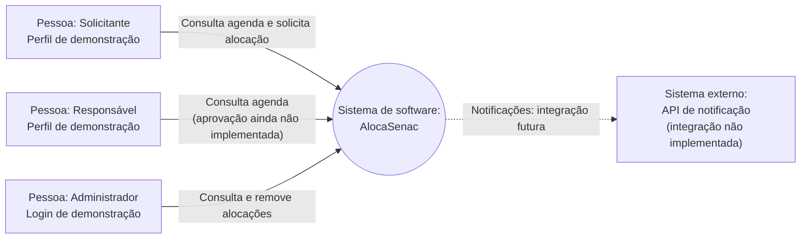
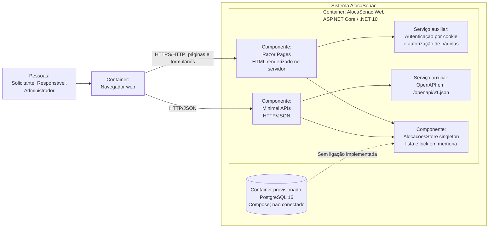
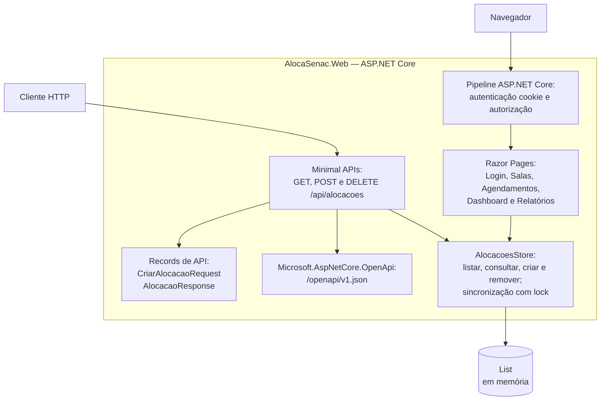
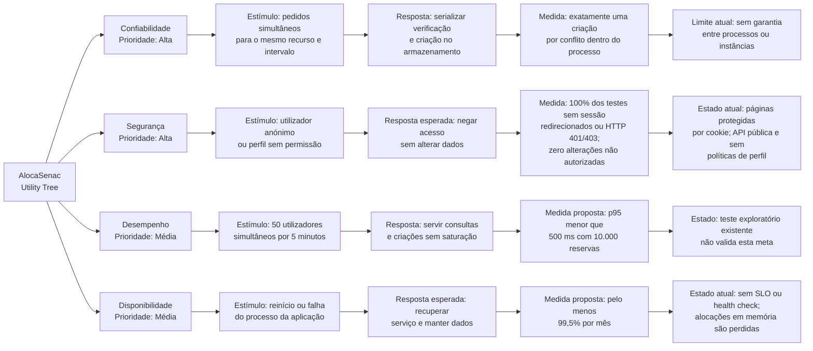

# Arquitetura e atributos de qualidade

## Escopo e stack identificada

O sistema executável é uma aplicação web ASP.NET Core no .NET 10. A interface é composta por Razor Pages e a API usa Minimal APIs com contrato OpenAPI em `/openapi/v1.json`. A autenticação de páginas usa cookies. O `AlocacoesStore` é um singleton com dados mantidos apenas na memória do processo.

O Docker Compose constrói e executa a aplicação e provisiona PostgreSQL 16 com volume persistente, mas a aplicação não se conecta a esse banco: não há configuração, driver ou repositório de persistência no fluxo atual. Os projetos `Application`, `Domain` e `Infrastructure` existem como estrutura, mas não contêm os componentes usados pelo fluxo de alocações atual. Não foi identificada integração com serviço externo de notificação.

## C4 — Nível 1: contexto

Os perfis abaixo são os atores apresentados na interface de demonstração, não papéis de autorização efetivos. O login atualmente cria apenas uma identidade de Administrador. A integração de notificação está representada como possibilidade futura, não como dependência executável.

## C4 — Nível 2: containers e infraestrutura de execução

O navegador comunica-se com o único container de aplicação por HTTP. Dentro dele há páginas Razor, endpoints Minimal API, autenticação por cookie e o armazenamento singleton em memória. PostgreSQL está presente no Compose, mas não existe conexão entre ele e a aplicação. O desenho inclui esse container para explicitar a infraestrutura provisionada e o limite atual de persistência.

## C4 — Nível 3: componentes do container web

O diagrama representa os caminhos encontrados no código, não garante que todas as telas apresentadas tenham handlers funcionais. Em particular, os formulários de catálogo e os botões de aprovação não realizam as operações que os seus rótulos sugerem.

## Utility Tree — ATAM

As prioridades refletem o impacto para os fluxos de reserva e o estado atual do produto. Os alvos quantitativos são critérios propostos para avaliação, não resultados medidos. A estratégia de medição de desempenho está descrita em `prd/requisitos-nao-funcionais.md`.

## Limites e pontos de evolução

- A sincronização de `AlocacoesStore` só coordena threads da mesma instância do processo.
- A base PostgreSQL provisionada não é utilizada pela aplicação; logo, volume e reinício de container não persistem as alocações atuais.
- Não há serviço externo de notificação, workflow funcional de aprovação ou gestão operacional de recursos e materiais.
- A API não exige autenticação; a autenticação de cookie é aplicada às pastas Razor configuradas em `Program.cs`.
- Para executar múltiplas instâncias com integridade concorrente, é necessária persistência compartilhada e uma estratégia transacional/constraint adequada ao modelo de intervalos.
