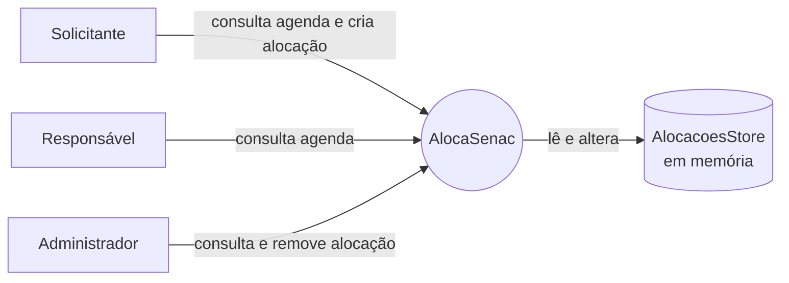
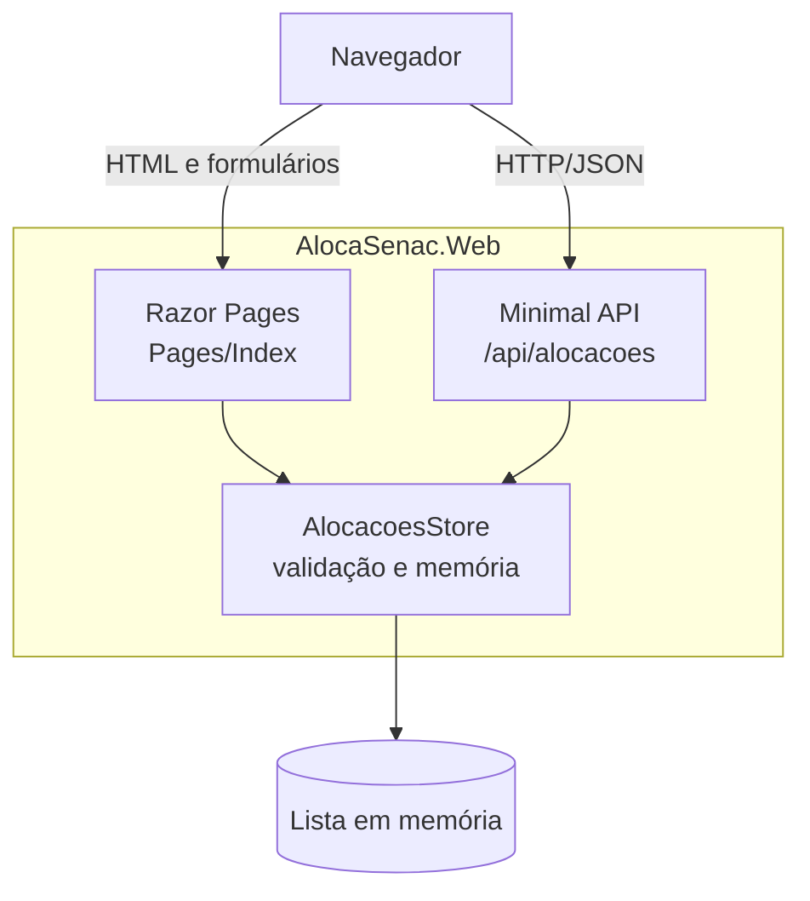

# Arquitetura (escopo atual)

Esta demonstração usa ASP.NET Core Razor Pages e Minimal APIs. Os perfis exibidos na interface não representam autenticação nem autorização. O `AlocacoesStore` mantém os dados em memória e os perde ao reiniciar o processo.

## Diagrama de contexto

## Diagrama de componentes

## Limites arquiteturais

O cadastro de alocação é confirmado imediatamente; não há fluxo de aprovação. A API ainda não impõe autenticação. Banco persistente, gestão de espaços/recursos e notificações não fazem parte do comportamento implementado nesta entrega.
