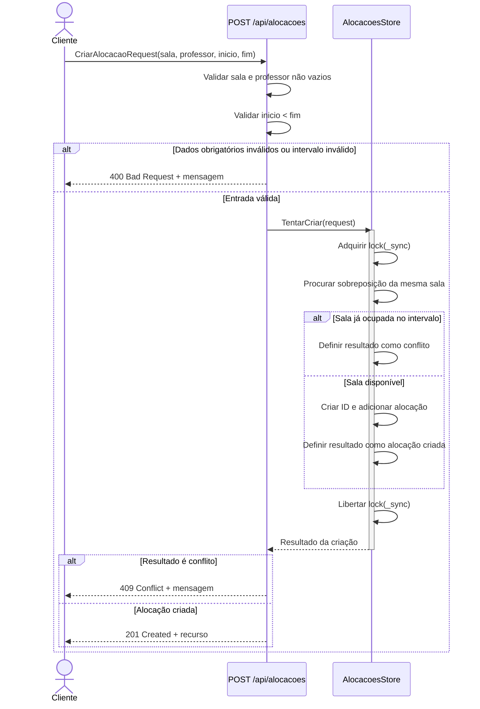
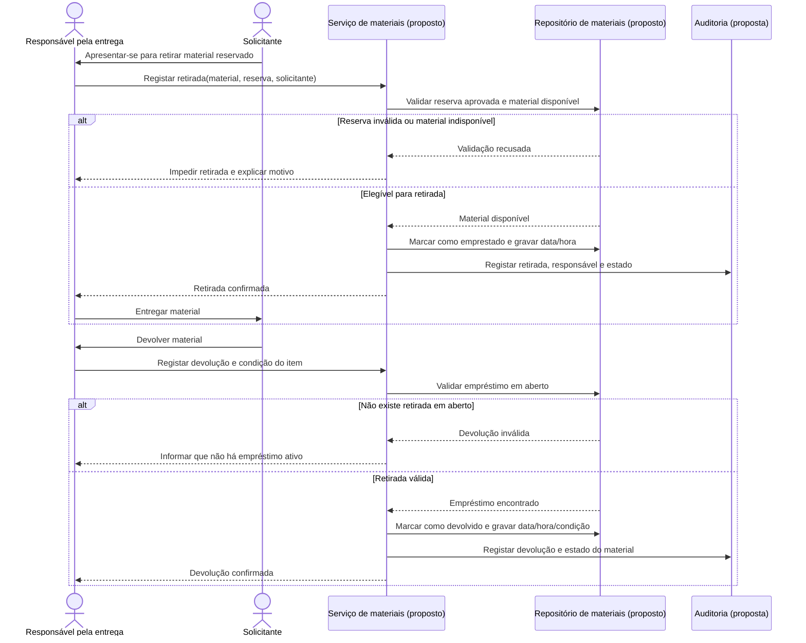

# Fluxos de sequência

Os diagramas distinguem os fluxos efetivamente implementados dos fluxos alvo exigidos pelo produto. Hoje a criação via API só verifica conflito de sala. Não há aprovação de recurso restrito nem registo de retirada/devolução de materiais; os diagramas c e d são propostas funcionais, não descrições do comportamento executável.

## a) Criar reserva com verificação de conflito — implementado via API

O formulário da página Agendamentos não está ligado a um handler de criação. O caminho funcional é `POST /api/alocacoes`, que valida campos e intervalo, verifica sobreposição da sala e responde com 201, 400 ou 409.



## b) Duas reservas simultâneas para o mesmo recurso — lock local

As chamadas podem chegar ao endpoint ao mesmo tempo, mas `lock (_sync)` em `TentarCriar` serializa a verificação e a inclusão dentro do singleton do processo. O pedido que obtiver o lock primeiro é aceite se não houver reserva; o seguinte encontra o conflito. A ordem dos pedidos é indeterminada. Isto não garante unicidade entre processos ou instâncias.

```mermaid
sequenceDiagram
    actor ClienteA
    actor ClienteB
    participant API as Minimal API
    participant Store as AlocacoesStore singleton

    par Pedidos concorrentes chegam
        ClienteA->>API: POST sala X, intervalo T
    and
        ClienteB->>API: POST sala X, intervalo T
    end
    API->>Store: TentarCriar(pedido A)
    API->>Store: TentarCriar(pedido B)
    Note over Store: A ordem de aquisição do lock depende do escalonamento.
    alt Pedido A adquire o lock primeiro
        Store->>Store: Verificar sala e intervalo de A
        Store->>Store: Sem conflito: inserir A
        Store->>Store: Libertar lock(_sync)
        Store-->>API: AlocacaoResponse de A
        API-->>ClienteA: 201 Created
        Store->>Store: B adquire lock e verifica intervalo
        Store->>Store: Conflito com A; libertar lock
        Store-->>API: null para B
        API-->>ClienteB: 409 Conflict
    else Pedido B adquire o lock primeiro
        Store->>Store: Verificar sala e intervalo de B
        Store->>Store: Sem conflito: inserir B
        Store->>Store: Libertar lock(_sync)
        Store-->>API: AlocacaoResponse de B
        API-->>ClienteB: 201 Created
        Store->>Store: A adquire lock e verifica intervalo
        Store->>Store: Conflito com B; libertar lock
        Store-->>API: null para A
        API-->>ClienteA: 409 Conflict
    end
```

O diagrama representa resultados alternativos para A/B: exatamente um pedido recebe 201 e o outro 409. A garantia é apenas em memória e por processo; persistência compartilhada exigiria controlo transacional no banco.

## c) Aprovação de recurso restrito pelo Responsável — fluxo alvo, não implementado

Não existem estado de recurso restrito, operação de aprovação ou autorização por Responsável. O fluxo abaixo especifica a interação esperada para implementação futura. A transição deve validar a identidade e manter o pedido pendente se a autorização falhar.

```mermaid
sequenceDiagram
    actor Solicitante
    actor Responsavel as Responsável autorizado
    participant API as Serviço de reservas (proposto)
    participant Auth as Autorização por perfil (proposta)
    participant Repo as Repositório persistente (proposto)
    participant Auditoria as Auditoria (proposta)

    Solicitante->>API: Solicitar recurso restrito
    API->>Repo: Gravar pedido com estado Pendente
    Repo-->>API: Pedido pendente
    API-->>Solicitante: Pedido submetido para aprovação
    Responsavel->>API: Aprovar pedido
    API->>Auth: Verificar papel e responsabilidade pelo recurso
    alt Utilizador não é Responsável autorizado
        Auth-->>API: Não autorizado
        API-->>Responsavel: 403 Forbidden; estado inalterado
    else Responsável autorizado
        Auth-->>API: Autorizado
        API->>Repo: Confirmar pedido pendente e verificar conflitos
        alt Conflito ou pedido já processado
            Repo-->>API: Não efetivado
            API-->>Responsavel: Conflito ou estado atual
        else Sem conflito e ainda pendente
            Repo-->>API: Estado atualizado para Aprovado
            API->>Auditoria: Registar autor, estado anterior/novo e instante
            API-->>Responsavel: Aprovação confirmada
            API-->>Solicitante: Notificação de aprovação (se configurada)
        end
    end
```

## d) Retirada e devolução de material — fluxo alvo, não implementado

O código atual não possui catálogo de materiais nem operações de empréstimo ou devolução. Este fluxo proposto pressupõe reserva aprovada, validação do responsável pela entrega e registo auditável de ambas as movimentações.

