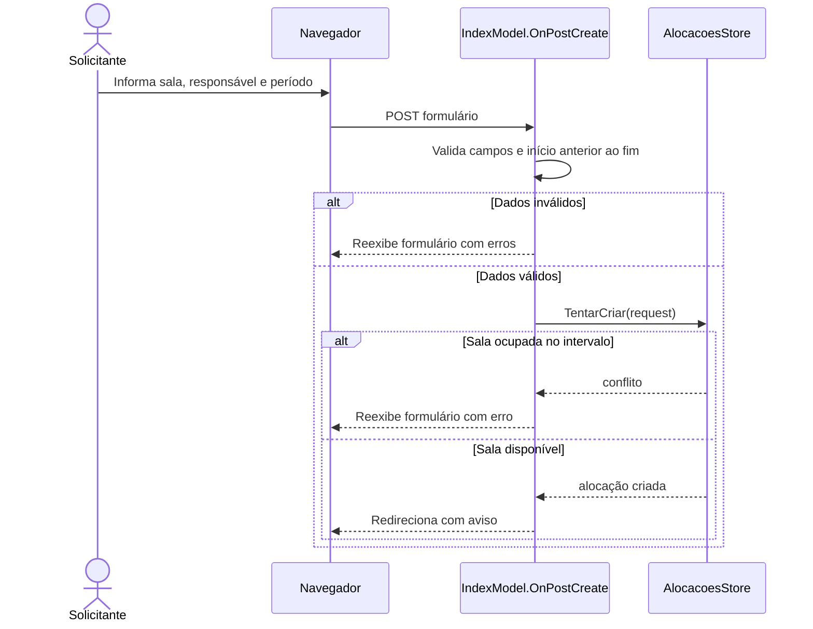
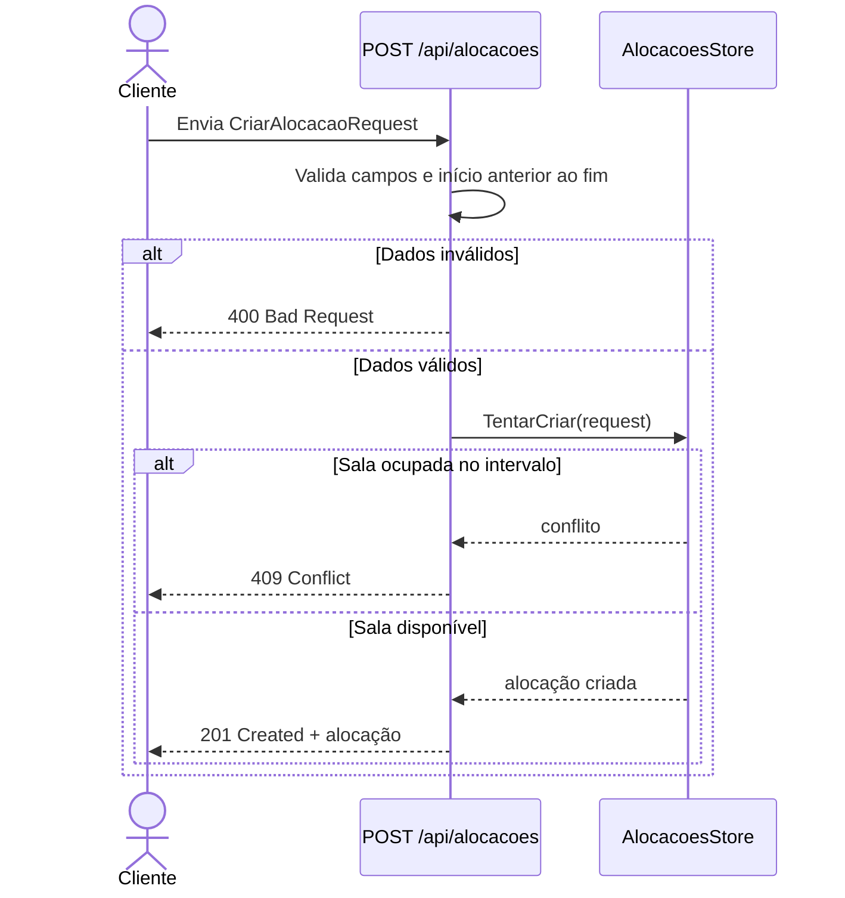
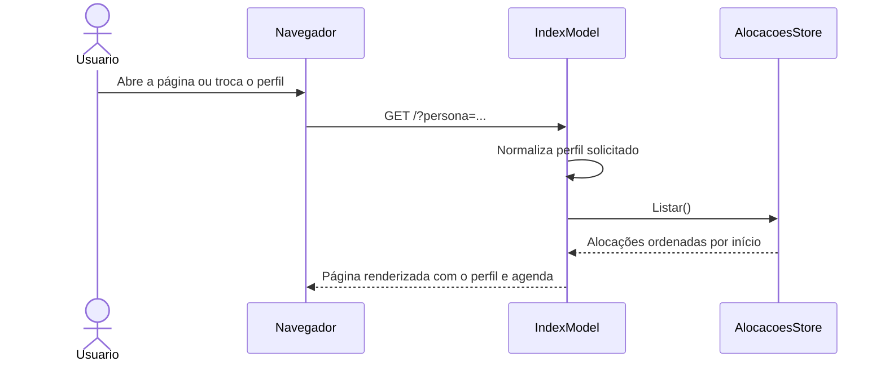
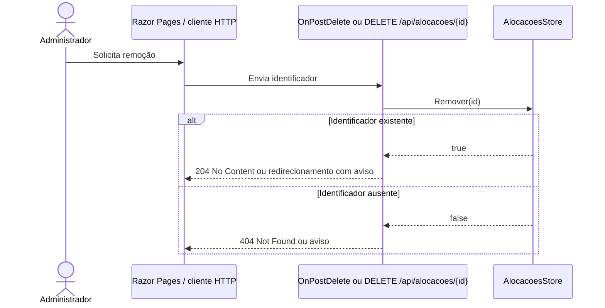

# Fluxos de sequência

## Criar alocação pela interface

## Criar alocação pela API

## Consultar agenda

## Remover alocação

> Os perfis da interface são demonstrativos e não autenticam o ator. A API não restringe a operação por perfil.